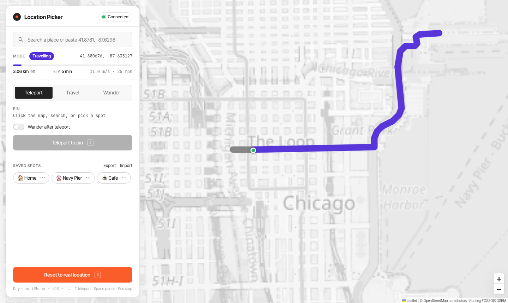

# locspoof: Location Picker for iPhone

Set **your own iPhone's** GPS location from a map in your Mac's browser. You can teleport anywhere,
travel along real roads at walking or driving speed, or wander naturally around a spot. Your real
location comes back with one click.

It uses Apple's built-in developer location simulation (the same feature Xcode uses to test apps).
There's no jailbreak and nothing to install on the phone, and turning it off is always easy.



**Features**

- **Teleport:** click the map, search a place, or paste coordinates
- **Travel:** follow real roads at walk/bike/drive/highway or custom speed, with multiple stops, pause/resume,
  live ETA, and optional realistic speed (traffic stops, slowing down on arrival)
- **Wander:** small natural movement around a spot (standing around, indoors, walking around, GPS drift)
- **Saved spots:** name your favorite places; rename, move, delete, import/export
- **Reset to real location** button, plus auto-restore when you quit
- Works over USB or Wi-Fi, with automatic reconnecting if the cable or Wi-Fi drops
- Dark mode, phone-friendly layout, keyboard shortcuts

---

## What you need

| | |
|---|---|
| **Mac** | macOS 13 or newer |
| **iPhone** | Any iPhone you own. Tested on iOS 26; works on iOS 15+ |
| **Cable** | USB cable for the first setup. Wi-Fi works afterwards (optional) |
| **Python** | 3.11 or newer ([python.org](https://www.python.org/downloads/macos/) or `brew install python`) |
| **Xcode** | **Not needed** |

Check your Python version with `python3 --version`.

---

## Setup (one time, about 10 minutes)

### 1. Download and install

```bash
git clone https://github.com/Eshwar-R-97/locspoof.git
cd locspoof
python3 -m venv .venv
.venv/bin/pip install -r requirements.txt
```

### 2. Connect and trust your iPhone

1. Plug the iPhone into your Mac and **unlock it**.
2. If it asks **"Trust This Computer?"**, tap **Trust** and enter your passcode.
3. Check that the Mac can see it:

   ```bash
   .venv/bin/python -m pymobiledevice3 usbmux list
   ```

   You should see your phone's name and iOS version. If you see `[]`, try another cable or port, unlock the
   phone, and try again.

### 3. Turn on Developer Mode (iOS 16 and newer)

The **Developer Mode** switch is hidden until a developer tool asks for it. To make it appear:

```bash
.venv/bin/python -m pymobiledevice3 amfi reveal-developer-mode
```

Then on the iPhone:

1. Open **Settings → Privacy & Security** and scroll to the very bottom. **Developer Mode** is now there.
   If Settings was already open, close it fully and reopen it.
2. Turn it **on** and tap **Restart**.
3. After the restart, unlock the phone, tap **Turn On** at the prompt, and enter your passcode.

Check that it worked:

```bash
.venv/bin/python -m pymobiledevice3 amfi developer-mode-status   # prints: true
```

> iOS 15 or older has no Developer Mode switch, so skip this step.

---

## Every time you use it

### 1. Start the tunnel (iOS 17 and newer)

Open a **separate Terminal window**, go to the `locspoof` folder, and run:

```bash
sudo .venv/bin/python -m pymobiledevice3 remote tunneld
```

Type your **Mac's** password; nothing shows while you type, which is normal. **Leave this window open** the
whole time. When you see `Created tunnel`, the phone is connected.

> `sudo` is needed because the tunnel creates a network interface on your Mac. If the log also says
> `Waiting user pairing consent`, that's a separate Wi-Fi pairing attempt. It doesn't block anything, and if
> your phone shows a trust prompt you can tap **Trust**.
>
> iOS 16 or older doesn't need this step.

### 2. Start the app

In your first Terminal window (in the `locspoof` folder):

```bash
.venv/bin/python run.py
```

You'll see something like:

```
  Location Picker 2.0.0
  Backend : auto (tunneld → legacy) → dvt
  Device  : My iPhone · iOS 26.6.1 · 0000XXXX-…
  Open    : http://127.0.0.1:8765/
```

The first connection may take a minute while it downloads Apple's developer disk image. This happens once.

### 3. Open the map

Go to **http://127.0.0.1:8765/** in your browser. The badge at the top should say **Connected** (green dot).

### 4. Stop

Press **Ctrl+C** in the app window. It restores your real location (`Restored real location.`).
Then press Ctrl+C in the tunnel window.

---

## How to use it

### Teleport
1. Click anywhere on the map, **search** a place, or **paste coordinates** like `40.6892, -74.0445` into the search box.
2. Press **Teleport to pin** (or the `T` key).
3. Open Apple Maps on the phone. Your blue dot moves within a few seconds.

Turn on **Wander after teleport** to keep moving slightly instead of sitting perfectly still.

### Travel
1. Open the **Travel** tab. If you haven't teleported yet, choose where to **Start from** (a saved spot or *Pick on map*).
2. Pick a destination (click, search, or tap a saved spot). Use **＋ Add pin as a stop** for stops along the way.
3. Choose a speed: **Walk · Bike · Drive · Highway · Custom**. The panel shows the route and an estimate like
   *4.2 km · 9 min by car*.
4. Optional:
   - **Realistic speed:** natural speed changes, traffic-light stops when driving, short pauses when walking.
   - **Match route's estimated time:** drives at the pace the routing service expects.
   - **Wander on arrival:** keep moving slightly once you get there.
5. Press **Start**. Use **Pause** / **Stop** (or `Space` / `Esc`) at any time.

If road routing fails or is slow, you can choose **Use a straight line instead**.

### Wander
Turn it on in the **Wander** tab and pick a style:

| Style | Looks like |
|---|---|
| Standing around | Small moves within ~20 m |
| Indoors | Slow moves within ~10 m |
| Walking around | Strolling within ~40 m |
| GPS drift only | A phone left on a table |

Adjust the radius with the slider.

### Saved spots
- Drop a pin, then **＋ Save pin**, give it a name, and optionally an emoji.
- Tap a spot to select it. Use **⋯** to Rename, Move to pin, Set as start, or Delete.
- **Export** / **Import** back up or share your spots as a JSON file.

### Keyboard shortcuts
`T` teleport to pin · `Space` pause/resume · `Esc` stop · `R` reset to real location · `/` search

### Getting your real location back
Use any of these:
- the orange **Reset to real location** button,
- **Ctrl+C** in the app window,
- **restarting the phone**, which always works no matter what.

---

## Good to know

- **Keep it connected.** On iOS 17+ the fake location lasts only while your Mac is awake, the tunnel window is
  open, and the phone is connected. The phone can be locked.
- **Cable unplugged?** The status changes to *Reconnecting*. Plug it back in. It reconnects and restores the
  location by itself, usually within a minute or two.
- **Restarting the app** offers to **Resume previous session?** It never moves your phone without you clicking.
- **Auto-reset:** `.venv/bin/python run.py --auto-reset-after 4h` restores your real location automatically after 4 hours.
- **Done for good?** Turn Developer Mode off in Settings → Privacy & Security.

### Optional: use it without a cable (Wi-Fi)
With the phone plugged in, run:

```bash
.venv/bin/python -m pymobiledevice3 lockdown wifi-connections on
```

After that, with the Mac and phone on the **same Wi-Fi network**, tunneld finds the phone without the cable.

### Optional: control it from your phone or another computer
By default the app only accepts connections from your own Mac. To open it from another device on your network,
choose a password-like token:

```bash
.venv/bin/python run.py --host 0.0.0.0 --token pick-a-long-secret
```

Open the URL it prints (it includes `?token=…`) once on the other device; the page remembers it after that.
Use this only on networks you trust.

### Try it without a phone
```bash
.venv/bin/python run.py --dry-run
```
Runs the whole app with a pretend iPhone, which is handy for trying it out.

---

## Troubleshooting

| Problem | Fix |
|---|---|
| `usbmux list` shows `[]` | Unlock the phone, tap **Trust**, and try another cable or port |
| No **Developer Mode** in Settings | Run `.venv/bin/python -m pymobiledevice3 amfi reveal-developer-mode` with the phone plugged in and unlocked, then fully close and reopen Settings |
| `Can't reach tunneld` | The tunnel window isn't running. Start it (step 1 under *Every time you use it*) |
| `No device in tunneld` | Unlock the phone, check the cable, and look for `Created tunnel` in the tunnel window |
| `sudo: .venv/bin/python: command not found` | Run the `sudo` command from inside the `locspoof` folder |
| `DeveloperDiskImage not mounted` / `InvalidService` | `.venv/bin/python -m pymobiledevice3 mounter auto-mount --tunnel ""`, and check that Developer Mode is on |
| Badge stuck on **Reconnecting** | Usually fixes itself within a minute or two. If not, unlock the phone and check the tunnel window |
| Page says `Missing or wrong token` | Open the exact URL the app printed (with `?token=`) |
| Location snaps back to real | Make sure the app and tunnel are still running. On iOS 17+ the fake location ends when the connection closes |
| Apple Maps moved but **Find My** didn't | Find My updates on its own schedule, often 1–2 minutes |
| Works in Maps but not in some app | Some apps also use Wi-Fi/cell-tower positioning, which this doesn't change |
| Several iPhones plugged in | Pick one with `--udid <UDID>` (the error message lists them) |
| Port 8765 already in use | `.venv/bin/python run.py --port 8766` |

For more detail, run with `-v` and check `data/locpicker.log`.

---

## All options

```
.venv/bin/python run.py [options]

  --dry-run                   pretend iPhone, no device needed
  --udid UDID                 which iPhone to use when several are connected
  --legacy                    force the iOS 16-and-older connection method
  --port 8765                 web page port
  --host 127.0.0.1            listen address (anything else requires --token)
  --token TOKEN               require this token for every request
  --auto-reset-after 4h       restore real location after a time (30m, 1h30m, 90s, …)
  --tick 1.0                  seconds between position updates while moving
  --data-dir ./data           where spots, logs and session state are stored
  --tunneld 127.0.0.1:49151   tunneld address
  --no-mount                  don't auto-mount the developer disk image
  -v                          verbose logging
```

Quick device test without the web app:

```bash
.venv/bin/python -m locpicker.backends --set -- 40.6892 -74.0445   # holds until Ctrl+C
.venv/bin/python -m locpicker.backends --clear
```

(Put `--` before coordinates so negative numbers aren't read as options.)

---

## Use it responsibly

This is for **your own device**: testing apps, protecting your privacy, development, and fun. Don't use it to
mislead people who rely on knowing where you are, to cheat in games or apps whose rules forbid it, or to get
around location-based laws or restrictions. You're responsible for how you use it.

## Limitations

- iOS 17+ needs the Mac on and connected the whole time.
- Apple can change these developer features in any iOS update. Tested with **pymobiledevice3 11.56.2**
  (pinned in `requirements.txt` as `>=11`). If an update breaks things, try
  `.venv/bin/pip install "pymobiledevice3==11.56.2"`.
- Search ([Nominatim](https://nominatim.org/)), road routing ([FOSSGIS OSRM](https://routing.openstreetmap.de/)) and
  map tiles ([OpenStreetMap](https://www.openstreetmap.org/)) are free community services with fair-use limits.
  Please use them lightly.
- Routes that cross the ±180° longitude line aren't supported.

---

## For developers

```bash
.venv/bin/python -m pytest -q
```

```
run.py               entry point: CLI flags, logging, startup banner, clean shutdown
locpicker/
  config.py          settings + CLI parsing
  geo.py             pure math: distance, bearing, interpolation, densify, simplify
  backends.py        device layer: DVT (iOS 17+), Legacy (≤16), Auto, Fake (dry-run/tests)
  engine.py          async state machine: teleport / travel / wander / pause, keepalive, reconnect
  spots.py           saved spots (atomic JSON writes, corrupt-file backup)
  server.py          aiohttp API + live updates (SSE), security checks, session save/resume
  static/            index.html, app.js, app.css (Leaflet, no build step)
tests/               unit + integration tests (fake clock, fake device)
```

**Security:** the server listens only on `127.0.0.1` by default and rejects requests from other websites
(CSRF) and spoofed hostnames (DNS rebinding). In network mode every API request needs the token.

Built on [pymobiledevice3](https://github.com/doronz88/pymobiledevice3) and [Leaflet](https://leafletjs.com/).
